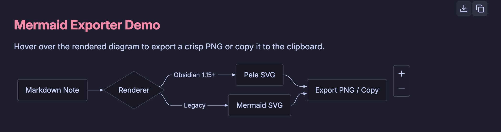
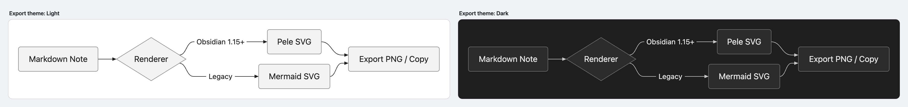

# Obsidian Mermaid Exporter

[](https://github.com/addozhang/obsidian-mermaid-exporter/releases/latest)
[](https://github.com/addozhang/obsidian-mermaid-exporter/actions/workflows/ci.yml)

[](LICENSE)

Export rendered Mermaid diagrams from Obsidian as high-DPI PNG images or copy them directly to the clipboard.



## Features

- **WYSIWYG Export** — Exports the diagram exactly as Obsidian renders it, including your current theme
- **Theme-aware colors & Export Themes** — Works with both renderers: Mermaid (Obsidian ≤ 1.14) and Pele (Obsidian ≥ 1.15), with optional fixed Light or Dark export palettes
- **Copy to Clipboard** — Puts the image on the system clipboard without touching the disk, ready to paste into chat, slides, or a PR
- **One-Click Save** — Writes the PNG through the browser download path, so it lands in your downloads folder without a dialog getting in the way
- **Configurable Resolution** — Scale factor from 1x to 4x (default 2x) for crisp high-DPI images
- **Seamless & Accessible UI** — Keyboard-focusable buttons fade in on hover, styled independently of Obsidian's internal classes
- **Works Everywhere** — Live Preview, Reading mode, and popout windows

## Installation

### From Community Plugins

1. Open **Settings → Community Plugins → Browse**
2. Search for **Mermaid Exporter**
3. Click **Install**, then **Enable**

### With BRAT (Beta / Pre-release)

1. Install the [BRAT](https://github.com/TfTHacker/obsidian42-brat) plugin from Community Plugins
2. Open **Settings → BRAT → Add Beta plugin**
3. Enter `addozhang/obsidian-mermaid-exporter` and click **Add Plugin**
4. Enable **Mermaid Exporter** in **Settings → Community Plugins**

### Manual Installation

1. Download `main.js`, `manifest.json`, and `styles.css` from the [latest release](https://github.com/addozhang/obsidian-mermaid-exporter/releases/latest)
2. Create folder: `<vault>/.obsidian/plugins/mermaid-exporter/`
3. Copy the three files into that folder
4. Reload Obsidian and enable the plugin in **Settings → Community Plugins**

## Usage

1. Create a mermaid code block in any note
2. Hover over the rendered diagram — two buttons fade in at the top-right
3. Click the download button to save a PNG, or the copy button to put it on the clipboard
4. The PNG lands in your downloads folder, named `mermaid-diagram-<timestamp>.png`

Both buttons honour the export settings below, so a copied image is byte-for-byte what "Export PNG" would have written.

## Settings

| Setting | Default | Description |
|---------|---------|-------------|
| Image scale | 2 | Resolution multiplier for exported PNG (1–4x) |
| Export theme | Match Obsidian | Colours baked into the PNG: follow the note, or always use Light / Dark |

### Export theme

`Match Obsidian` keeps whatever colours the diagram is rendered with. `Light` and `Dark` always export a fixed palette, which is what you want when the image lands in a document with a background you don't control — a light blog post, a dark slide deck, a PDF.



Pele drives every colour through CSS variables, so switching theme is a recolour, not a re-render: label positions, shapes and line breaks stay exactly as measured. Any palette the diagram sets itself (e.g. `%%{init: {"themeVariables": {"pie1": "#..."}}}%%`) is left alone in every theme.

This applies to diagrams drawn by Pele (Obsidian 1.15 and later). Diagrams rendered by the older Mermaid engine bake their colours into the SVG, so they always export as rendered.

## Privacy

- **No network access.** The plugin makes no requests and collects no telemetry. It works entirely on the diagram already rendered in the note.
- **The clipboard is write-only.** The copy button puts the finished PNG on the system clipboard and reads nothing back — your clipboard contents are never inspected, stored or sent anywhere.
- **No filesystem access.** The plugin never opens, reads or writes a path directly. Saving hands the PNG to the browser download path, so it lands in your downloads folder like any other download.

## Requirements

- Obsidian ≥ 1.5.0
- Desktop only (Windows / macOS / Linux)

## How it works

Obsidian 1.15 replaced its bundled Mermaid renderer with [Pele](https://pele.run/), which paints diagrams with CSS variables (`fill="var(--_fg)"`, `stroke="var(--_l)"`, …) and keeps those variables in the root `<svg>`'s inline `style`. Before an SVG can be rasterized through a canvas it has to be serialized into a data URL, where the document stylesheet no longer applies. The plugin therefore resolves every `var()` reference against the live, themed element before serializing — so the PNG keeps the colors, corner radii and fonts you see in the note, and the canvas is filled with the diagram's own background instead of a hard-coded white.

Mermaid's pre-1.15 output is still handled: HTML labels inside `<foreignObject>` are converted to `<text>`, `:root` rules are stripped, and percentage-based sizing is replaced with the viewBox dimensions.

## Development

```bash
git clone https://github.com/addozhang/obsidian-mermaid-exporter.git
cd obsidian-mermaid-exporter
npm install
npm run dev            # watch mode
npm run build          # production build
npm run lint           # typecheck + community-review lint rules (TS/JS and CSS)
npm test               # unit tests (Vitest + jsdom)
npm run test:coverage  # unit tests with coverage report
```

To test locally, symlink or copy `main.js`, `manifest.json`, and `styles.css` into your vault's `.obsidian/plugins/mermaid-exporter/` directory. For live Obsidian end-to-end tests over Chrome DevTools Protocol, see [scripts/e2e/README.md](scripts/e2e/README.md).

## Contributing

See [CONTRIBUTING.md](CONTRIBUTING.md) for development setup, bug reports, and pull request guidelines.

## License

[MIT](LICENSE) — Addo Zhang
